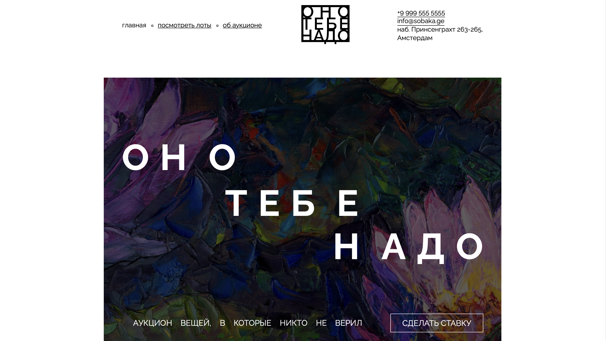

# ono-tebe-nado-fd

учебный проект по вёрстке сайта «оно тебе надо».

## описание проекта

«оно тебе надо» — сайт-аукцион вещей, в которые никто не верил.

## технологии

- HTML5
- CSS3
- Flexbox
- CSS Grid

## как запустить проект

откройте файл `index.html` в браузере.

## скриншот проекта

## статус проекта

учебный проект по вёрстке, выполненный в рамках курса «фронтенд-разработчик» на яндекс практикуме.

## скриншот проекта

